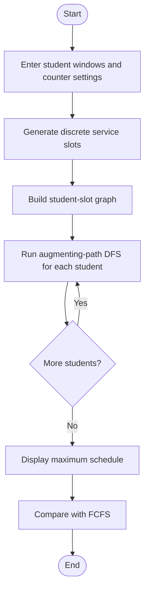

# MessMate — College Mess Meal Scheduler
## DAA Mini Project Report | SY BTech CSE | AY 2026–27

> Fill team names, PRNs and guide details. Insert screenshots and actual compiler/test output from the final C application before printing.

## 1. Team Details
- Student 1: [Name] | PRN: [PRN]
- Student 2: [Name] | PRN: [PRN]
- Student 3: [Name] | PRN: [PRN]
- Faculty Guide: [Name]

## 2. Problem Statement and Objectives
During a short meal break, students have different availability windows and a single counter serves one student per fixed service slot. Assign feasible slots to maximize the number of students served. Objectives: collect windows; generate feasible service slots; optimize assignments; show unserved students; compare with FCFS.

## 3. Existing Approach
FCFS serves in arrival order. A flexible student may take a slot that is the only feasible slot for a student with a narrow window. Matching can reassign flexible students to preserve scarce slots.

## 4. DAA Strategy
**Graph Algorithms — Maximum Bipartite Matching.** Left vertices represent students; right vertices represent discrete service start slots. Add an edge only when the complete service interval fits in that student's availability. An augmenting-path DFS finds a maximum-cardinality matching.

Assumptions: one counter, common fixed service duration, discrete time grid, maximum 100 students and 200 slots in this implementation. The solution is exact for this discretized model, not arbitrary continuous-time scheduling or different service durations.

## 5. Pseudocode
```text
Generate all service start slots within mess hours
For every student, connect all slots that fit their window
Initialize all slots as unmatched
Order students by fewest feasible slots
For each student:
  Clear visited-slot set
  Run DFS augmenting path:
    For each adjacent unvisited slot:
      Mark slot visited
      If slot is free OR its owner can be reassigned recursively:
        Assign this slot to current student
        Return success
Return matched assignments and unserved students
```

## 6. Flowchart


## 7. Implementation
- Language: C11
- GUI: Raylib 5.x
- Algorithm: `scheduler.c/.h`
- GUI: `main.c`
- Tests: `tests/test_scheduler.c`
- Build: Makefile; Clang on macOS or MinGW-w64/MSYS2 GCC on Windows.

## 8. Complexity Analysis
Let (n) be students, (s) service slots, (V=n+s), and (E) feasible student-slot edges. The augmenting-path algorithm has worst-case **O(VE)** time; graph storage is **O(V+E)**. Building the adjacency matrix is **O(ns)** time and the implementation's fixed adjacency storage is **O(ns)** space. The DFS recursion depth is bounded by the number of slots.

## 9. Testing and Results
Run `make test` in MessMate. Paste actual compiler/test output and add screenshots of the student list, optimized schedule and FCFS comparison.

## 10. Comparison
Use a flexible student and a constrained student to demonstrate reassignment: FCFS may consume the constrained student's only slot, while matching finds two assignments. Report the actual output from the test program.

## 11. Conclusion and Future Scope
MessMate models counter allocation as bipartite matching. Future scope: multiple counters, variable service durations, multiple meal counters, saved schedules and continuous-time models.

## 12. References
- Course notes/textbook: [Add exact reference]
- C language reference: https://en.cppreference.com/w/c
- Raylib documentation: https://www.raylib.com/
