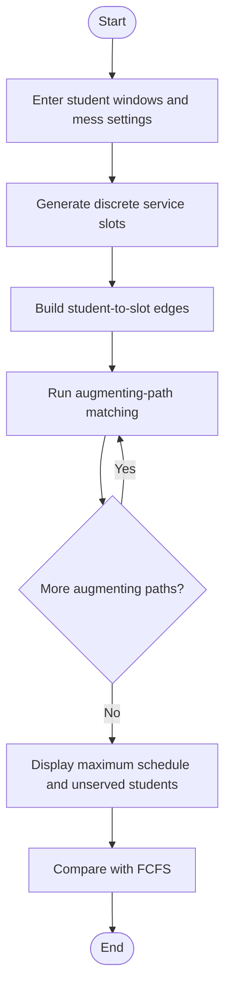

# MessMate — College Mess Meal Scheduler
## DAA Mini Project Report Template | SY BTech CSE | AY 2026–27

> Complete the team and guide fields and insert screenshots/output captured from the final running application before printing.

## 1. Team Details
- Student 1: [Name] | PRN: [PRN]
- Student 2: [Name] | PRN: [PRN]
- Student 3: [Name] | PRN: [PRN]
- Faculty Guide: [Name]

## 2. Problem Statement
During a short college meal break, students have different free-time windows. A single mess counter can serve only one student at a time. The objective is to assign feasible service slots so that the maximum number of students receive their meal within their individual availability windows.

## 3. Objectives
- Accept student names and availability windows.
- Model the counter's operating period as fixed-length service slots.
- Assign each student to at most one feasible slot and each slot to at most one student.
- Maximize the number of students served.
- Compare the result with a first-come-first-served (FCFS) baseline.

## 4. Existing / Basic Approach
A simple FCFS queue serves students in arrival order. It is easy to implement, but an early-arriving student with a wide availability window may occupy a slot that is the only feasible option for a student with a narrow window. MessMate compares FCFS with a matching-based assignment.

## 5. Selected DAA Strategy
**Graph Algorithms — Maximum Bipartite Matching.**

Construct a bipartite graph:
- Left vertices: students.
- Right vertices: discrete service start slots.
- Edge (student, slot): the full service interval beginning at that slot lies inside that student's availability window.

A matching is a set of edges with no shared endpoints. Therefore, no student receives two slots and no slot serves two students. An augmenting-path algorithm repeatedly finds a path that increases the matching size. When no augmenting path remains, the matching is maximum-cardinality.

### Assumptions and scope
- One serving counter.
- All students require the same configurable service duration.
- Slot start times lie on a configurable fixed time grid (default 5 minutes).
- A service interval must fit completely inside the student's availability window and the mess opening hours.
- This is an exact maximum-cardinality solution for the discretized model implemented by the program. It does not claim to solve arbitrary continuous-time scheduling or varying service durations.

## 6. Algorithm / Pseudocode
```text
CREATE all feasible service slots
FOR each student u:
    CONNECT u to every slot that fits u's availability window
matching = empty
ORDER students by number of feasible slots (fewest first)
FOR each student u:
    RUN DFS augment(u), tracking visited slots
    IF a free slot is found:
        assign it to u
    ELSE if an occupied slot can be reassigned recursively:
        reassign it and assign the freed slot to u
RETURN matched student-slot pairs and unmatched students
```

### Flowchart


## 7. Implementation Details
- Language: Python 3
- GUI: Tkinter / ttk
- Algorithm module: `scheduler.py`
- GUI module: `app.py`
- Tests: `tests/test_scheduler.py`
- Inputs: student name, available-from and available-until times, opening/closing times, service duration, slot interval.
- Outputs: assigned service intervals, unserved names, count served, FCFS comparison.

## 8. Complexity Analysis
Let:
- (n) = number of students
- (s) = number of generated service slots
- (V=n+s) = total graph vertices
- (E) = number of feasible student-slot edges

The augmenting-path DFS implementation has worst-case time complexity **O(VE)**. Building the graph takes **O(ns)** in the straightforward implementation (and (E le ns)). The graph and matching require **O(V+E)** space. The worst-case bound is the safe general bound for this implementation; average runtime depends on graph density and the order/structure of feasible windows, so no fixed average-case bound is claimed.

## 9. Testing and Results
Run:
```bash
python -m unittest discover -s tests -v
```
Insert the actual test output and screenshots here:
- [Screenshot 1: main GUI with student records]
- [Screenshot 2: optimized schedule]
- [Screenshot 3: FCFS comparison]
- [Test output: paste actual run]

## 10. Comparison
Compare the number served by maximum matching and FCFS on the same input. Include a small hand-worked test case showing how an augmenting path can reassign an earlier flexible student to a later slot, freeing the constrained slot for another student.

## 11. Conclusion and Future Scope
MessMate demonstrates how a real-world allocation problem can be modelled as a bipartite graph and solved for maximum cardinality. Future work may include multiple counters, different service durations, continuous-time scheduling, meal categories, and saving schedules to a database.

## 12. References
- Course material / lecture notes: [Add exact course reference]
- Python documentation: https://docs.python.org/3/
- Tkinter documentation: https://docs.python.org/3/library/tkinter.html
- Graph algorithm reference used by the team: [Add textbook/author/edition and relevant chapter]
