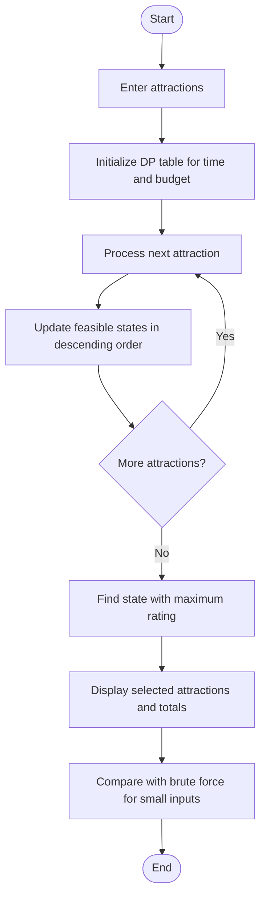

# TripWise — Tourist Attraction Planner
## DAA Mini Project Report | SY BTech CSE | AY 2026–27

> Fill team names, PRNs and guide details. Insert screenshots and actual compiler/test output from the final C application before printing.

## 1. Team Details
- Student 1: [Name] | PRN: [PRN]
- Student 2: [Name] | PRN: [PRN]
- Student 3: [Name] | PRN: [PRN]
- Faculty Guide: [Name]

## 2. Problem Statement and Objectives
A tourist has limited time and money. Each attraction has a visit duration, entry cost and rating. Select a subset maximizing total rating without exceeding either limit. Objectives: enter attraction data; optimize under both limits; display selected attractions and aggregate metrics; validate small cases against brute force.

## 3. Existing Approach
Greedy selection by rating or rating-to-cost ratio can miss a better combination because two independent resource constraints must be satisfied simultaneously. Dynamic Programming considers reachable time-budget states.

## 4. DAA Strategy
**Dynamic Programming — 0/1 Knapsack with two constraints.** Each attraction is selected at most once. A state indexed by (used time, used budget) stores the maximum rating achievable. For each attraction, iterate resource coordinates in descending order so the same attraction cannot be reused during the current iteration.

Assumptions: ratings are additive integer points; duration is positive; cost and rating are non-negative integers; attractions are independent. Travel time, opening hours and route order are excluded.

## 5. Pseudocode
```text
Initialize DP[0][0] = 0 and all other states unreachable
For each attraction i:
  For time from T down to duration[i]:
    For cost from B down to cost[i]:
      If predecessor state is reachable:
        candidate = predecessor rating + rating[i]
        If candidate improves current state:
          Store candidate and selected-attraction bit mask
Return feasible state with maximum rating
```

## 6. Flowchart


## 7. Implementation
- Language: C11
- GUI: Raylib 5.x
- Algorithm: `optimizer.c/.h`
- GUI: `main.c`
- Tests: `tests/test_optimizer.c`
- Build: Makefile; Clang on macOS or MinGW-w64/MSYS2 GCC on Windows.
- Brute-force comparison is limited to 22 attractions.
- GUI defaults: 480 minutes and ₹3,000; these are constants in the current version.

## 8. Complexity Analysis
Let (n) be attractions, (T) the time limit and (B) the budget limit in integer units. Dense two-dimensional DP has **O(nTB)** worst-case time and **O(TB)** space. The implementation stores a fixed-size score, reachability flag and 64-bit selection mask per state, so the asymptotic space remains O(TB). The implementation caps the table at 2 million cells. Brute force is **O(n·2^n)** time and O(1) auxiliary space apart from its result structure.

## 9. Testing and Results
Run `make test` in TripWise. Paste actual terminal output and insert screenshots of the running GUI, input data, optimized plan and DP/brute-force validation.

## 10. Comparison
For small datasets compare the DP objective value with enumeration of all subsets. Record both results and verify selected plans obey both limits.

## 11. Conclusion and Future Scope
TripWise demonstrates multi-constraint optimization using DP. Future extensions include editable trip limits, travel-time matrices, route order, opening hours, multi-day planning and live attraction information.

## 12. References
- Course notes/textbook: [Add exact reference]
- C language reference: https://en.cppreference.com/w/c
- Raylib documentation: https://www.raylib.com/
